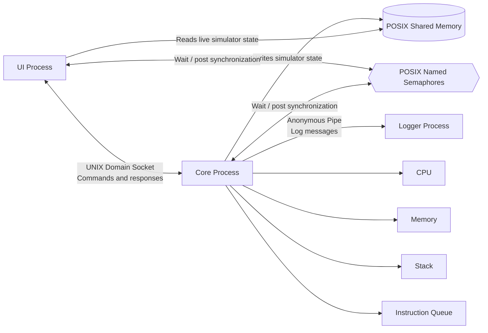

# CPU Simulator – IPC Techniques (Week 2)

## Project overview

This project implements a simple CPU simulator using three independent processes:

1. **UI Process** – accepts user commands and displays simulator information.
2. **Core Process** – executes CPU operations and manages Memory, Stack, and the Instruction Queue.
3. **Logger Process** – receives log messages from Core and writes them to `simulator.log`.

The processes communicate using Inter-Process Communication (IPC) mechanisms provided by POSIX/Linux. The three source files `ui.c`, `core.c`, and `logger.c` each contain their own `main()` function and are compiled as separate executables.

## IPC architecture

The following diagram shows the IPC paths used by the normal simulator runtime.



### Process responsibilities

| Process | Responsibility |
|---|---|
| UI | Reads commands from the user, sends them to Core, receives responses, and displays simulator state. |
| Core | Executes CPU instructions and manages CPU registers, Memory, Stack, and Instruction Queue. It handles UI communication, updates shared state, and sends log messages to Logger. |
| Logger | Receives log messages from Core and records them in `simulator.log`. |

## IPC mechanisms and reasons for selection

The normal runtime uses UNIX Domain Sockets, POSIX Shared Memory, POSIX Named Semaphores, and an Anonymous Pipe.

| IPC mechanism | Used between | Purpose in this project | Reason for selecting it |
|---|---|---|---|
| **UNIX Domain Socket** | UI ↔ Core | Transfers commands from UI to Core and sends command responses back to UI. | Both processes run on the same machine, so a local socket provides two-way communication without network communication. It supports a clear request-and-response interface between the UI and Core. |
| **POSIX Shared Memory** | Core → shared state → UI | Core publishes the current simulator state, and UI reads it for live state display. | Shared memory allows both processes to access the same state region directly. It is suitable for sharing structured state without sending the entire state through repeated socket messages. |
| **POSIX Named Semaphores** | UI ↔ Core | Coordinates access to shared state and allows UI to wait until Core has initialized the shared resources. | Semaphores provide synchronization when multiple processes access shared data. They help prevent the UI from reading shared state while Core is updating it and coordinate startup readiness. |
| **Anonymous Pipe** | Core → Logger | Transfers log messages from Core to the Logger process. | Core launches Logger as its child process, so a pipe is a simple one-way communication channel for sending log messages between related processes. |

### Communication flow

1. The Core process starts and initializes the shared-memory region and named semaphores.
2. Core starts the Logger process and connects the pipe used for log messages.
3. The UI connects to Core using the UNIX Domain Socket.
4. The UI sends a command through the socket. Core processes it and returns a response.
5. Core updates the simulator state in shared memory. The semaphores coordinate access while the state is read or updated.
6. Core sends log messages to Logger through the anonymous pipe. Logger writes the received messages to `simulator.log`.

### Note about POSIX message queues

`ipc_common.h` contains message-queue definitions, and `logger.c` retains a standalone legacy message-queue mode. However, the normal Core-launched simulator uses the anonymous pipe for Core-to-Logger communication. POSIX message queues are therefore **not part of the normal runtime communication path**.

## Source files

| File | Purpose |
|---|---|
| `core.c` | Core process; executes CPU commands and manages Memory, Stack, Instruction Queue, socket communication, shared memory, and the Logger pipe. |
| `ui.c` | User interface; accepts commands, communicates with Core, and displays simulator state. |
| `logger.c` | Logger process; receives messages through the pipe and writes `simulator.log`. |
| `sync.c` | POSIX semaphore helper implementation. |
| `sync.h` | Semaphore function declarations. |
| `sim_interface.h` | Shared-state structure and socket/shared-memory/semaphore names. |
| `ipc_common.h` | Message structures, command types, constants, and legacy message-queue definitions. |
| `Makefile` | Builds the three executables. |

## Requirements

- Linux or WSL Ubuntu
- GCC
- GNU Make
- POSIX shared memory, semaphores, sockets, and pipes

On Ubuntu/WSL, install the build tools if needed:

```bash
sudo apt update
sudo apt install build-essential
```

## Compilation

Open a terminal in the `Week 2` directory and run:

```bash
make
```

This creates three executables:

- `core`
- `ui`
- `logger`

To remove the executables and generated log:

```bash
make clean
```

## Running the simulator

Use **two Ubuntu/WSL terminals**, both opened in the same `Week 2` directory.

**Terminal 1 – start Core:**

```bash
./core
```

Core initializes shared memory and semaphores, creates the local socket, and starts the Logger process automatically.

**Terminal 2 – start UI:**

```bash
./ui
```

Enter commands in the UI terminal. The Logger writes entries to `simulator.log` in the project directory.

## Available UI commands

| Command | Description |
|---|---|
| `LOAD <value>` | Load a value into the accumulator |
| `ADD <value>` | Add a value to the accumulator |
| `SUB <value>` | Subtract a value from the accumulator |
| `PUSH <value>` | Push a value onto the stack |
| `POP` | Pop a value into the accumulator |
| `STORE <address>` | Store the accumulator in memory |
| `LOADM <address>` | Load a memory value into the accumulator |
| `PRINT` | Print the accumulator |
| `SHOW CPU` | Display CPU information |
| `SHOW MEMORY` | Display non-zero memory cells |
| `SHOW STACK` | Display stack information |
| `SHOW QUEUE` | Display instruction-queue information |
| `STATE` | Read the live simulator state from shared memory |
| `EXIT` | Exit the simulator |

## Example test

Enter these commands in the UI:

```text
LOAD 10
ADD 5
SHOW CPU
STATE
EXIT
```

Expected CPU values after `LOAD 10` and `ADD 5`:

```text
ACC = 15
PC = 2
```

## Implementation notes

- Start Core before starting UI.
- Run the commands from the project directory so Core can find `./logger`.
- Do not compile all `.c` files into one executable: `core.c`, `ui.c`, and `logger.c` each contain their own `main()` function and must be built as separate processes.
- Core removes its named shared-memory and semaphore objects during normal shutdown.
- The current implementation uses a synchronous command-response flow; this README does not claim that separate worker threads are used.
